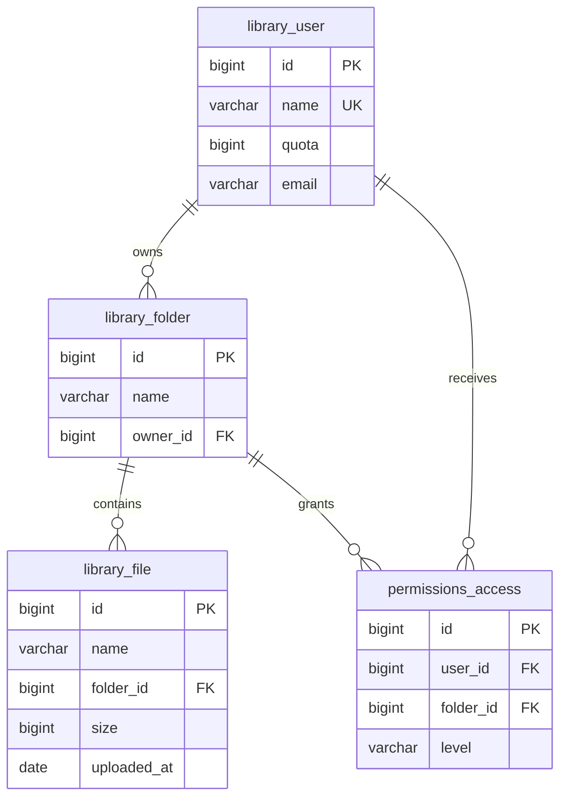

# База данных файлового хранилища

## Требования и границы

Приложение — монолит Django: представления, операции с данными и шаблоны
работают в одном проекте. Основная база — SQLite, доступ к ней выполняется
через Django ORM. Она хранит метаданные файлов, а не их содержимое.

| Действие | Необходимые данные и правила |
| --- | --- |
| Создать пользователя | Уникальное имя, квота в байтах, необязательный email |
| Создать папку | Имя и владелец; имена одного владельца не повторяются |
| Добавить файл | Папка, имя, размер, дата; имя уникально внутри папки |
| Предоставить доступ | Получатель, папка, одно право read или write |
| Изменить файл | Право записи; общий размер файлов владельца не превышает квоту |
| Найти файлы | Имя, папка, владелец, размер, дата; сортировка и пагинация |
| Получить статистику | Количество файлов, суммы размеров, свободное место |
| Удалить объект | Папка с файлами и пользователь с папками защищены от удаления |

У пользователя может быть несколько папок. Файл принадлежит ровно одной папке,
а его размер учитывается в квоте владельца этой папки. Вложенных папок нет.
Владелец управляет доступом; отдельная запись Access для него не требуется.
Права принадлежат папке и распространяются на её файлы. Отсутствие Access
означает отсутствие предоставленного права, поэтому значение `none` не хранится.

## Схема и связи



Связи User → Folder и Folder → File имеют тип «один ко многим».
User ↔ Folder для совместного доступа — «многие ко многим» через Access,
где хранится дополнительный атрибут level. Это отдельная связь от владения.
На диаграмме UK у имени пользователя означает уникальность выражения LOWER(name).
Составные уникальные ключи перечислены ниже.

Модели: [library/models.py](../../library/models.py) и
[permissions/models.py](../../permissions/models.py).
NamedEntity — абстрактная модель с полем name, отдельной таблицы для неё нет.
Поле Folder.members использует существующую таблицу Access;
дополнительная таблица ManyToMany не создаётся.

## Поля таблиц

Все поля обязательны (`NOT NULL`), кроме email. У каждой таблицы есть
автоматический первичный ключ id — BigAutoField; в SQLite это
`INTEGER PRIMARY KEY AUTOINCREMENT`. Внешние ключи имеют тип `bigint`.
Значения по умолчанию ниже задаёт Django при создании объекта;
постоянные SQL DEFAULT для этих полей не объявлены.

| Таблица | Поле | Тип Django / объявление SQLite | Значение и ограничения |
| --- | --- | --- | --- |
| library_user | id | BigAutoField / integer | Первичный ключ |
| library_user | name | CharField / varchar(255) | Уникальность LOWER(name) |
| library_user | quota | PositiveBigIntegerField / bigint unsigned | CHECK ≥ 0; по умолчанию 104857600 байт |
| library_user | email | EmailField / varchar(254) | NULL допустим, адрес необязательный, не уникальный |
| library_folder | id | BigAutoField / integer | Первичный ключ |
| library_folder | name | CharField / varchar(255) | Уникально в пределах владельца |
| library_folder | owner_id | ForeignKey / bigint | Ссылка на library_user.id |
| library_file | id | BigAutoField / integer | Первичный ключ |
| library_file | name | CharField / varchar(255) | Уникально в пределах папки |
| library_file | folder_id | ForeignKey / bigint | Ссылка на library_folder.id |
| library_file | size | PositiveBigIntegerField / bigint unsigned | CHECK ≥ 0; по умолчанию 0 байт |
| library_file | uploaded_at | DateField / date | По умолчанию текущая дата, без времени |
| permissions_access | id | BigAutoField / integer | Первичный ключ |
| permissions_access | user_id | ForeignKey / bigint | Ссылка на library_user.id |
| permissions_access | folder_id | ForeignKey / bigint | Ссылка на library_folder.id |
| permissions_access | level | CharField / varchar(5) | CHECK IN ('read', 'write'); по умолчанию read |

SQLite использует динамическую типизацию: объявление varchar(255) само по себе
не ограничивает длину строки. Формат email, длины строк, непустое имя,
отсутствие пробелов по краям и разделителей пути проверяются в `full_clean()`.
Встроенный LOWER SQLite без расширений преобразует регистр ASCII; уникальность
без учёта регистра для всех символов Unicode сейчас не гарантируется.

## Целостность и операции

| Ограничение | Назначение |
| --- | --- |
| unique_user_name | Не допускает повтор LOWER(name) пользователя |
| unique_owner_folder | UNIQUE(owner_id, name) |
| unique_folder_file | UNIQUE(folder_id, name) |
| unique_user_folder_access | UNIQUE(user_id, folder_id) |
| valid_access_level | Допускает только read и write |
| CHECK для size и quota | Не допускает отрицательные значения |
| FK | Не допускает ссылку на отсутствующего пользователя или папку |

Имена папок и файлов сравниваются с учётом регистра. В SQL нет ограничения,
которое проверяет сумму размеров всех файлов владельца относительно квоты.
Это межстрочное правило проверяет File.clean(). Access.clean() запрещает
отдельное право для владельца. Эти проверки не вызываются автоматически
при обычном save(), objects.create() или QuerySet.update().

Операции изменения файлов выполняются через
[library/services.py](../../library/services.py): `save_file` проверяет право
записи, вызывает full_clean и сохраняет объект внутри транзакции. `delete_file`
проверяет право записи; `set_access` разрешён только владельцу и проверяет
создаваемое право. Для прямого создания User и Folder через shell также нужно
вызывать full_clean перед save.

При удалении средствами ORM `PROTECT` защищает владельца с папками и папку
с файлами. `CASCADE` удаляет права при удалении их получателя или папки.
Эту политику выполняет Django; она не означает наличие SQL ON DELETE CASCADE
в созданной SQLite-схеме. Сами внешние ключи остаются защитой на уровне БД.

`select_for_update()` в save_file не обеспечивает блокировку строки в SQLite.
Текущая конфигурация рассчитана на локальную работу; при переходе к конкурентным
записям потребуется пересмотреть транзакции, включая перенос файла между
владельцами, и использовать СУБД с блокировками строк. Простое добавление
индекса эту задачу не решает.

## Нормализация

**Первая нормальная форма:** поля содержат одно значение, списки файлов и прав
не записываются в ячейки. Каждая строка имеет первичный ключ.

**Вторая нормальная форма:** атрибуты зависят от целого ключа. В Access право
level относится к паре (user_id, folder_id), а не только к пользователю
или папке. Имя и квота пользователя хранятся в User, имя папки — в Folder.

**Третья нормальная форма:** неключевые атрибуты не дублируют характеристики
других сущностей. В File нет owner_id или owner_name: владелец определяется
через folder_id → Folder.owner_id. В Access не копируются имена участников.
При переименовании пользователя достаточно обновить одну запись.

Денормализация сейчас не применяется. Сохранённый used_bytes в User ускорил бы
проверку квоты, но его пришлось бы изменять при добавлении, удалении, изменении
размера и переносе файла. Сбой обновления дал бы неверный остаток квоты.
Поэтому размер считается из File. При подтверждённой нагрузке можно ввести
счётчик с транзакционным обновлением и периодической сверкой с SUM(size).

## Запросы и индексы

Первичные ключи, ограничения уникальности и внешние ключи уже обеспечивают
базовый доступ по идентификаторам и связям. Уникальные индексы
(owner_id, name) и (folder_id, name) также подходят для поиска внутри владельца
или папки. Отдельный индекс для каждого поля не нужен: он занимает место и
увеличивает стоимость INSERT, UPDATE и DELETE.

Миграция [0003_file_query_indexes.py](../../library/migrations/0003_file_query_indexes.py)
добавляет два составных индекса:

| Индекс | Поля в порядке обхода | Запрос веб-каталога |
| --- | --- | --- |
| file_folder_date_idx | folder_id ASC, uploaded_at DESC, id ASC | `/files/?folder=1&sort=date` |
| file_size_id_idx | size DESC, id ASC | `/files/?size=500000&sort=size` |

Первый индекс сначала сужает выборку до папки, затем выдаёт записи по дате.
Второй обслуживает диапазон размера и сортировку по убыванию. id задаёт
стабильный порядок при равных значениях, необходимый для пагинации.
Другие сочетания фильтров могут потребовать иной план; эти индексы не обещают
ускорить все запросы. Поиск `icontains` с подстрокой в середине имени обычно
не получает такого выигрыша от обычного B-tree; полнотекстовый поиск
пока не добавлен.

### Измерение

После `python manage.py migrate` в окружении Django:

```bash
python manage.py profile_indexes
```

[Команда](../../library/management/commands/profile_indexes.py) копирует текущую
SQLite-базу в память, заменяет только в копии предметные данные синтетическим
набором: один владелец, 20 папок и 50 000 файлов. Она сравнивает два ORM-запроса
с LIMIT 10 до и после создания соответствующего индекса, печатает
EXPLAIN QUERY PLAN и медиану 25 выполнений. Совпадение строк проверяется.
Запросы выбирают id и name; это измерение основной выборки, без JOIN владельца,
COUNT для пагинатора и рендеринга полной страницы.

[Результат запуска](index_profile.json):

| Выборка | До, мс | После, мс | Изменение плана |
| --- | ---: | ---: | --- |
| Файлы папки по дате | 0.2817 | 0.0024 | Индекс FK + временная сортировка → составной индекс |
| Файлы по размеру | 0.9957 | 0.0024 | Полный просмотр + временная сортировка → поиск по индексу |

Время зависит от устройства, версии SQLite, распределения данных и состояния
кэша. Это синтетическое измерение в памяти, а не время ответа сайта.
Решение об индексах опирается прежде всего на изменение плана запроса.

### Агрегирование и кэширование

[db/views.py](../../db/views.py) использует Count, Sum, Min, Max и Avg на стороне
БД. annotate группирует показатели по папкам и датам, подзапрос подсчитывает
объём файлов владельца, F использует значения колонок в выражении свободного
места. Суммы не сохраняются отдельными строками. select_related в представлениях
загружает связанные папки и владельцев вместе с файлами, сокращая число запросов.

Общий прикладной кэш не включён: объём данных небольшой, а статистика должна
сразу отражать изменения. Если измерения покажут дорогие повторные чтения,
можно кэшировать сводную статистику с коротким TTL, например 30 секунд.
Ключ должен учитывать пользователя и параметры фильтров; после успешной
транзакции изменения данных кэш потребуется сбрасывать. Проверку доступа и
квоты нельзя строить только на устаревшем кэше. Пока это проектное решение
для развития, а не действующий механизм.

## Защита данных

| Область | Текущее состояние | Решение для размещения с реальными данными |
| --- | --- | --- |
| Доступ к операциям | Сервисы проверяют actor_id, владельца и Access | Связать actor_id с аутентифицированным пользователем; проверять чтение и запись на сервере |
| Просмотр через сайт | Локальный каталог доступен целиком, аутентификации нет | Ограничить выборки владельцем и предоставленными правами |
| SQL-инъекции | ORM параметризует значения, сортировки выбираются из разрешённого списка | Сохранить этот подход для новых запросов |
| Вывод имён | Автоэкранирование шаблонов, проверка имён в моделях | Не отключать экранирование пользовательских строк |
| Доступ к SQLite | У SQLite нет отдельных серверных пользователей БД | Запуск от отдельного пользователя ОС; права 0600 на БД и 0700 на каталог с журналами и копиями |
| Шифрование на диске | Обычный SQLite без шифрования | Шифрование тома, например FileVault, и зашифрованные резервные копии; ключи отдельно от копий и Git |
| Передача данных | Локальный HTTP на 127.0.0.1 | HTTPS при сетевом размещении |
| Конфигурация | DEBUG=False по умолчанию, локальные ALLOWED_HOSTS; есть локальный SECRET_KEY | Отдельный секрет через DJANGO_SECRET_KEY и настройки развёртывания |

Шифрование файловой системы и права ОС в рамках этой практики не изменяются.
Они защищают от чтения диска или копий посторонним, но не заменяют авторизацию
в приложении. Пользователь User сейчас — запись каталога, без пароля и сессии;
переданный вручную actor_id не подтверждает личность человека.

## Миграции и сохранность

Схема ПР9 сохранена, новая миграция добавляет только индексы: поля, ID,
связи и данные не переписываются. Применение выполняет обычный `migrate`.
Обратная миграция удаляет эти индексы, оставляя записи на месте:

```bash
python manage.py migrate library 0002
python manage.py migrate
```

Перенос из прежней SQLite-базы выполняет `import_legacy`: чтение источника,
валидация, сохранение идентификаторов и атомарная запись в пустую Django-базу.
Для логической резервной копии предметных таблиц используются dumpdata и
loaddata, описанные в README. Восстановление следует проверять в отдельной базе;
loaddata может заменить строки с совпавшими ID.

## Проверка

- `pytest -q`: 121 тест пройден, включая ограничения БД и неизменность
  пользовательских записей после профилирования.
- `flake8` и `manage.py check`: без замечаний.
- `makemigrations --check --dry-run`: модели соответствуют миграциям.
- В отдельную базу на схеме 0002 импортированы данные ПР7, затем выполнены
  переходы 0002 → 0003 → 0002 → 0003. Все строки четырёх предметных таблиц
  совпали с исходными после каждого перехода; индексы появились, удалились
  и появились повторно.

## Источники

- [Оптимизация запросов Django](https://docs.djangoproject.com/en/5.2/topics/db/optimization/).
- [Планировщик SQLite и составные индексы](https://www.sqlite.org/queryplanner.html).
- [Механизмы безопасности Django](https://docs.djangoproject.com/en/5.2/topics/security/).
